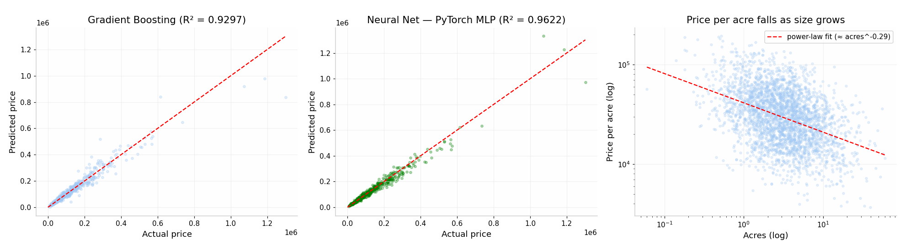

# 🏞️ Plot Price Predictor

**ML + Deep Learning API that estimates land plot prices** from size (acres), location,
zoning, road access, and frontage — with an honest 4-model comparison
(Ridge → Random Forest → Gradient Boosting → PyTorch Neural Net).

Built to plug into a real-estate platform (Laravel/PHP frontend → this Python API).



## Why not just `price = acres × rate`?

Price **per acre decreases as plot size grows** (bulk discount — a power law, ≈ acres^-0.29
in this dataset). Location and zoning shift the curve up or down. This project models all
of that jointly.

## Results (test set, 20% holdout)

| Model | MAE | RMSE | MAPE | R² |
|---|---|---|---|---|
| Ridge (baseline) | $36,700 | $66,094 | 57.2% | 0.7465 |
| Random Forest | $19,689 | $44,612 | 15.5% | 0.8845 |
| Gradient Boosting | $17,028 | $34,802 | 13.2% | 0.9297 |
| **Neural Net (PyTorch MLP)** | **$12,626** | **$25,525** | **9.9%** | **0.9622** |

The MLP wins here via log-target training (`log1p(price)`) + early stopping. On weaker
tabular signals gradient boosting often ties — the comparison table, not a single model,
is the point.

## Quickstart

```bash
pip install -r requirements.txt
uvicorn app.main:app --reload        # API on :8000, docs at /docs
streamlit run app/streamlit_demo.py  # demo UI on :8501
```

## API

```bash
curl -X POST http://localhost:8000/predict -H "Content-Type: application/json" -d '{
  "acres": 2.5, "location": "Lakeview", "zoning": "residential",
  "road_access": "paved", "corner_plot": true,
  "distance_to_city_km": 4.0, "frontage_m": 30.0
}'
```

Returns predictions from **all four models** plus a recommended estimate with a ±MAPE range.

## Retrain

```bash
python src/train.py     # rewrites models/ + metrics.json
```

Swap in XGBoost by uncommenting two lines in `src/train.py`.

## Deploy

Dockerfile + docker-compose included. See [docs/AWS_DEPLOYMENT.md](docs/AWS_DEPLOYMENT.md)
for AWS App Runner / EC2 / SageMaker instructions.

## Data

`data/plot_listings.csv` is a **synthetic demo dataset** (3,000 rows) generated with
realistic real-estate economics. Drop in scraped listings (same columns) and retrain —
no code changes needed.

## Stack

FastAPI · scikit-learn · PyTorch · Docker · AWS (App Runner) · GitHub Actions CI

MIT License
